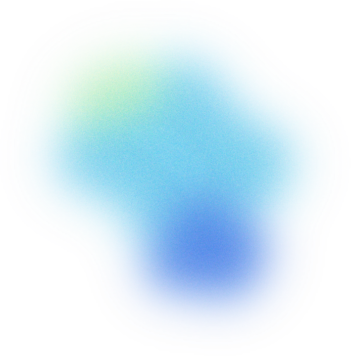
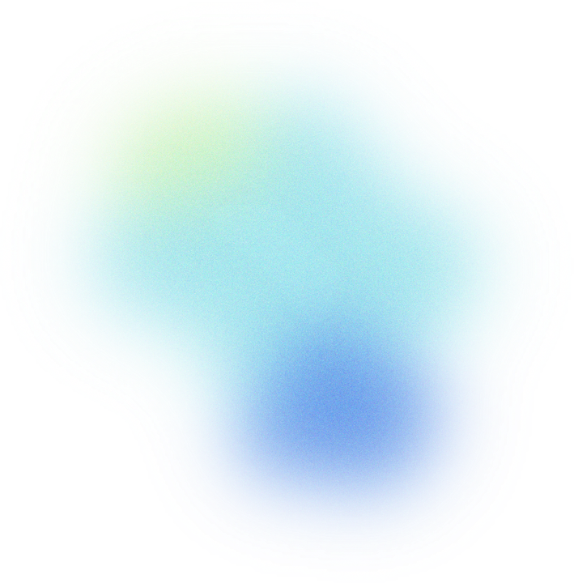

## Thay đổi riêng cho reel Claude Ultra (01/11/2026), ưu tiên hơn các mục bên dưới

- **Phông chữ:** Lexend cho mọi chữ trong video, theo quy ước ảnh đồ họa của trung tâm. JetBrains Mono chỉ cho chữ giao diện như `Settings > Usage`.
  ```css
  @font-face { font-family: "Lexend"; src: url("assets/fonts/Lexend-Variable.ttf") format("truetype"); font-weight: 100 900; font-display: block; }
  @font-face { font-family: "JetBrains Mono"; src: url("assets/fonts/JetBrainsMono-Medium.ttf") format("truetype"); font-weight: 500; font-display: block; }
  ```
- **Màu theo chủ thể:** Ultra dùng màu cam đất `--ultra` #C15F3C, `--ultra-soft` #F6E7E0, `--ultra-ink` #9A4526 khi chữ mang màu này trên nền sáng. Max dùng tím thương hiệu `--max` #5154F5. Pro dùng xám `--pro` #8387B8. Giới hạn 5 giờ dùng xanh ngọc `--five` #35C2D7, giới hạn tuần dùng mực `--week` #12143A.
  ```css
  #root { --ultra: #c15f3c; --ultra-soft: #f6e7e0; --ultra-ink: #9a4526; --max: #5154f5; --pro: #8387b8; --five: #35c2d7; --week: #12143a; }
  ```
- **Nguồn:** nhãn nguồn ghi đúng nơi: "Nguồn: @claudeai, 30/10/2026", "Nguồn: claude.com/pricing", "Nguồn: support.claude.com". Con số 20x theo phiên 5 giờ không có trong thông báo, nhãn ghi "Tên gói cũ, theo bảng giá trước đây".
- **Trung lập:** đây là bản tin, không quảng cáo cho Anthropic và không chê. Không dùng chữ "tuyệt vời", "cắt giảm", "giấu". Không vẽ logo Claude hay Anthropic; tên hãng viết bằng Lexend. Ảnh bằng chứng là ảnh chụp trang công khai.
- **Biểu đồ:** chiều cao cột là mức dùng mỗi tuần so với Pro, thang từ 0: Pro 1, Max 5, Ultra 10. Con số 20x không được vẽ thành cột cạnh ba cột này vì khác đại lượng.
- **Giao diện minh họa:** cảnh Settings > Usage là hình tự vẽ, không phải ảnh chụp tài khoản thật, phải có nhãn "Minh họa".
- **Ngữ pháp chuyển động** (giữ của các reel trước): phần tử đáp xuống lưới đúng nhịp lời, nhanh ra rồi nảy nhẹ (`back.out(1.3)`); số lớn đứng riêng; ảnh bằng chứng lộ ra bằng dải sáng hoặc bút tô.
- **Bài học từ các reel trước:** cảnh vào bằng chuyển "light" thì nội dung chỉ vào từ khoảng 0,35-0,45 s; số khóa đúng chữ trong lời đọc (đo theo từ); ảnh bằng chứng phải cắt cho chữ trong ảnh cao từ khoảng 30 px; chữ thông tin tối thiểu 30 px.

## Tổng quan

Reel giữ đúng tinh thần "ánh sáng trên kính" của template CAAITE: nền lụa trắng ngả tím hoặc mảng gradient indigo sang xanh trời, dải kính cong, đốm sáng mint và lam, thẻ kính bo góc, logo chữ A có quỹ đạo và ngôi sao bốn cánh. Khác với video mẫu của kênh tin AI (nền đen, chữ đỏ), reel này sáng và sạch như slide của trung tâm.

Ý tưởng hình (một câu): **"Bản tin trên kính"**, mỗi dữ kiện đáp xuống thành một thẻ kính hoặc một con số nét mảnh trên nền của template, còn ngôi sao bốn cánh của logo CAAITE làm con trỏ dẫn mắt từ tin này sang tin khác.

## Motif bắt buộc

1. Hai loại nền luân phiên: nền lụa sáng (slide 1, 3, 7) và mảng gradient indigo -> sky (slide 2, 6, 9, 13).
2. Số thứ tự nét mảnh kiểu "01 02 03" và số trang "02 / 08" của template làm bộ đếm mục.
3. Thẻ kính bo góc (slide 4): trên nền gradient là nền trắng 14-18%, viền trắng 2px 55%; trên nền sáng là nền trắng 72%, viền lilac 2px, bóng indigo nhẹ.
4. Logo lớn tràn mép góc dưới phải (slide 2, 6, 9, 13) trong cảnh gradient; trên nền sáng dùng logo-glow.
5. Nhãn nhỏ "Trung tâm Đào tạo AI Chuyên sâu" ở góc trên trái suốt video.
6. Ngôi sao bốn cánh: lóe sáng ở câu mở, làm gạch đầu dòng, dẫn đường khi chuyển cảnh, bừng sáng ở khung kết.

## Số liệu trên hình

- Mỗi cảnh chỉ một con số chính, cỡ lớn nét 300; tối đa 3 thanh so sánh (GPT-6.1 Sol luôn là thanh nổi bật: nền sáng dùng dải indigo #5152F6 -> #3D63DB, nền brand dùng trắng; mô hình khác dùng #8387B8 trên nền sáng, trắng 42% trên nền brand). Mọi thanh có nhãn trực tiếp tên mô hình và giá trị; chữ luôn màu --fg, không lấy màu thanh.
- Không trục, không lưới, không chú giải rời; nhãn ghi thẳng cạnh thanh.
- Mọi cảnh có số liệu ghi "Nguồn: OpenAI" (nhãn Work Sans 22-24px).
- Số viết kiểu Việt Nam: dấu phẩy thập phân (6,4), "USD" sau số (2 USD).

## Do

- Chữ tiếng Việt đủ dấu, Be Vietnam Pro; câu dài dùng nét 300-400.
- Chuyển động mượt, có hướng: thẻ trượt lên kèm nhòe -> nét, thanh mọc từ trái, số đếm lên, ngôi sao quét chéo theo dải sáng của template.
- Nền luôn có chuyển động chậm (đốm sáng thở, dải sáng trôi, logo trôi nhẹ).

## Don't

- Không nền đen, không neon đỏ/tím hồng, không chữ gradient cầu vồng.
- Không vẽ lại logo khác đi; chỉ dùng path gốc (assets/brand/caaite-logo-paths.json) hoặc logo-glow.png.
- Không đặt chữ dưới 22px; không đặt chữ trong vùng giao diện nền tảng.
- Không bịa số, không làm tròn khác bài gốc.

## Bộ thành phần dùng chung (chép nguyên văn vào mỗi cảnh, chỉ đổi phần trong ngoặc nhọn)

Cập nhật sau lượt `hyperframes check` đầu tiên (30/09/2026): chữ phụ và accent trên nền sáng đậm hơn (0,76 và #2F55D4), chữ phụ trên nền brand gần đặc (0,96), thẻ kính trên nền brand ngả indigo khói, viên "TIN AI" và nhãn nguồn trên nền brand có nền tối nhẹ, để mọi chữ đạt tương phản WCAG AA.

Mọi id/class riêng của cảnh phải có tiền tố `fNN-` (NN là số cảnh, ví dụ `f03-bar-sol`), vì id CSS không được bắt đầu bằng chữ số (`#03-...` là bộ chọn hỏng); data-composition-id vẫn là frame_id (`03-price`). Các lớp dùng chung dưới đây giữ tên `k-...` nhưng luôn viết dưới bộ chọn `#root` của cảnh để không đụng cảnh khác. Canvas 1080x1920. Chủ đề cảnh: `data-theme="brand"` (nền gradient, chữ trắng) hoặc `data-theme="light"` (nền lụa, chữ ink).

### Font (đặt trong `<style>` của template)

```css
@font-face { font-family: "Be Vietnam Pro"; src: url("assets/fonts/BeVietnamPro-Light.ttf") format("truetype"); font-weight: 300; font-display: block; }
@font-face { font-family: "Be Vietnam Pro"; src: url("assets/fonts/BeVietnamPro-Regular.ttf") format("truetype"); font-weight: 400; font-display: block; }
@font-face { font-family: "Be Vietnam Pro"; src: url("assets/fonts/BeVietnamPro-Medium.ttf") format("truetype"); font-weight: 500; font-display: block; }
@font-face { font-family: "Be Vietnam Pro"; src: url("assets/fonts/BeVietnamPro-SemiBold.ttf") format("truetype"); font-weight: 600; font-display: block; }
@font-face { font-family: "Work Sans"; src: url("assets/fonts/WorkSans-Variable.ttf") format("truetype"); font-weight: 100 900; font-display: block; }
```

### Biến màu và lớp chung

```css
#root { position: absolute; inset: 0; overflow: hidden; font-family: "Be Vietnam Pro", sans-serif; }
#root[data-theme="light"] { --fg: #12143a; --fg-soft: rgba(18, 20, 58, 0.76); --accent: #2f55d4; --accent-2: #35c2d7; --track: rgba(18, 20, 58, 0.08); --other: #8387b8; --sol: linear-gradient(90deg, #5152f6 0%, #3d63db 100%); color: var(--fg); }
#root[data-theme="brand"] { --fg: #ffffff; --fg-soft: rgba(255, 255, 255, 0.96); --accent: #a4e9ec; --accent-2: #ffffff; --track: rgba(255, 255, 255, 0.16); --other: rgba(255, 255, 255, 0.42); --sol: #ffffff; color: var(--fg); }
/* Nền: đặt trên một phần tử class="clip" track 0 suốt cảnh, không đặt trên #root */
#root .k-bg { position: absolute; inset: 0; overflow: hidden; }
#root .k-bg-grad { position: absolute; inset: 0; background: linear-gradient(160deg, #5154f5 0%, #4878eb 50%, #3ca7de 100%); }
#root .k-bg-plate { position: absolute; left: -54px; top: -96px; width: 1188px; height: 2112px; object-fit: cover; }
#root .k-bg-arc { mix-blend-mode: soft-light; opacity: 0.22; }
#root .k-bg-grain { position: absolute; inset: 0; background: url("assets/brand/grain-512.png") repeat; background-size: 512px 512px; mix-blend-mode: soft-light; opacity: 0.04; }
#root .k-blob { position: absolute; width: 900px; height: 900px; }
/* Thanh tiêu đề: y 150-198 */
#root .k-hdr { position: absolute; left: 72px; right: 72px; top: 150px; height: 48px; display: flex; align-items: center; gap: 18px; }
#root .k-hdr-label { font-family: "Work Sans", sans-serif; font-size: 24px; font-weight: 500; letter-spacing: 0.12em; text-transform: uppercase; color: var(--fg-soft); }
#root .k-hdr-pill { font-family: "Work Sans", sans-serif; font-size: 22px; font-weight: 600; letter-spacing: 0.08em; text-transform: uppercase; padding: 5px 16px 6px; border-radius: 999px; border: 2px solid var(--accent); color: var(--accent); }
#root[data-theme="brand"] .k-hdr-pill { color: #ffffff; border-color: rgba(255, 255, 255, 0.78); background: rgba(18, 20, 58, 0.16); }
#root .k-hdr-count { margin-left: auto; font-size: 30px; font-weight: 300; color: var(--fg-soft); letter-spacing: 0.02em; }
#root .k-hdr-count b { font-weight: 400; color: var(--fg); }
/* Nhãn nguồn: y 1182-1212, ngay trên vùng phụ đề */
#root .k-src { position: absolute; left: 72px; top: 1182px; font-family: "Work Sans", sans-serif; font-size: 22px; font-weight: 500; letter-spacing: 0.1em; text-transform: uppercase; color: var(--fg-soft); }
#root[data-theme="brand"] .k-src { color: #ffffff; background: rgba(18, 20, 58, 0.36); padding: 5px 14px 6px; border-radius: 999px; }
/* Thẻ kính */
#root[data-theme="brand"] .k-glass { background: rgba(28, 32, 120, 0.26); border: 2px solid rgba(255, 255, 255, 0.55); border-radius: 36px; box-shadow: 0 30px 60px rgba(18, 20, 58, 0.18); }
#root[data-theme="light"] .k-glass { background: rgba(255, 255, 255, 0.74); border: 2px solid #dee0fd; border-radius: 36px; box-shadow: 0 30px 60px rgba(81, 84, 245, 0.14); }
/* Số lớn nét mảnh kiểu template */
#root .k-num { font-weight: 300; font-size: 240px; line-height: 0.9; letter-spacing: -0.03em; font-variant-numeric: tabular-nums; }
#root .k-num-unit { font-weight: 400; font-size: 64px; letter-spacing: 0; margin-left: 12px; }
#root .k-kicker { font-family: "Work Sans", sans-serif; font-size: 26px; font-weight: 500; letter-spacing: 0.12em; text-transform: uppercase; color: var(--accent); }
#root .k-title { font-weight: 300; font-size: 104px; line-height: 1.04; letter-spacing: -0.02em; }
#root .k-body { font-weight: 400; font-size: 40px; line-height: 1.3; color: var(--fg-soft); }
/* Thanh so sánh ngang: GPT-6.1 Sol dùng dải logo-fill, mô hình khác dùng --other */
#root .k-bar { position: relative; width: 100%; }
#root .k-bar-label { display: flex; justify-content: space-between; align-items: baseline; font-size: 36px; font-weight: 500; margin-bottom: 14px; }
#root .k-bar-value { font-weight: 400; font-size: 44px; font-variant-numeric: tabular-nums; }
#root .k-bar-track { position: relative; width: 100%; height: 60px; border-radius: 999px; background: var(--track); overflow: hidden; }
#root .k-bar-fill { position: absolute; left: 0; top: 0; width: 100%; height: 100%; border-radius: 999px; transform-origin: left center; background: var(--other); }
#root .k-bar-fill.is-sol { background: var(--sol); }
/* Màu thanh đã chạy bộ kiểm tra của skill dataviz (validate_palette.js, 30/09/2026): nền sáng #3D63DB/#8387B8
   đạt tách màu CVD 13,9 và thị giác thường 15,3, tương phản >= 3:1; nền brand dùng trắng / trắng 42%.
   Mọi thanh PHẢI có nhãn trực tiếp (tên mô hình + giá trị) để không nhận diện bằng màu đơn thuần. */
/* Viên thuốc */
#root .k-chip { display: inline-flex; align-items: center; gap: 14px; padding: 14px 28px; border-radius: 999px; font-size: 34px; font-weight: 500; }
#root[data-theme="light"] .k-chip { background: #ffffff; border: 2px solid #dee0fd; color: var(--fg); }
#root[data-theme="brand"] .k-chip { background: rgba(255, 255, 255, 0.16); border: 2px solid rgba(255, 255, 255, 0.5); color: #ffffff; }
```

### Khung HTML chung của một cảnh

```html
<template>
  <style> /* @font-face + các lớp trên + CSS riêng của cảnh */ </style>
  <div id="root" data-composition-id="{frame_id}" data-theme="{brand|light}" data-width="1080" data-height="1920" data-duration="{duration}">
    <!-- Nền: một clip suốt cảnh, track 0 -->
    <div id="f{NN}-bg" class="k-bg clip" data-start="0" data-duration="{duration}" data-track-index="0">
      <!-- brand -->
      <div class="k-bg-grad"></div>
      
      <div class="k-bg-grain"></div>
      <!-- light (thay cho ba dòng trên):
      
      
      
      <div class="k-bg-grain"></div> -->
    </div>
    <!-- Thanh tiêu đề -->
    <div class="k-hdr" id="f{NN}-hdr"><span class="k-hdr-label">Trung tâm Đào tạo AI Chuyên sâu</span><span class="k-hdr-pill">Tin AI</span><span class="k-hdr-count"><b>{NN}</b> / {TT}</span></div>
    <!-- Nội dung cảnh trong x 72-1008, y 260-1170 -->
    <!-- Nhãn nguồn nếu cảnh có số liệu -->
    <div class="k-src" id="f{NN}-src">Nguồn: OpenAI</div>
  </div>
  <script> /* một timeline paused, đăng ký window.__timelines["{frame_id}"] */ </script>
</template>
```

Các tấm nền dọc có sẵn (1188x2112, dư 10% để trôi chậm): `assets/plates/silk-v.jpg` (lụa trắng), `arc-violet-v.jpg`, `arc-blue-v.jpg` (vòm kính), `ribbed-v.jpg` (kính gân), `deep-v.jpg` (kính đậm, hợp chữ trắng), `waves-v.jpg` (sóng lam). Nền luôn trôi chậm (x/y 20-40px hoặc scale 1.0 -> 1.04 suốt cảnh).

### Logo và ngôi sao

- Logo trắng (nền brand): `assets/brand/caaite-logo-white.svg`; logo gradient (nền light): `assets/brand/caaite-logo-gradient.svg`; logo có quầng sáng: `assets/template/logo-glow.png`. Tỉ lệ logo 1,392 : 1. Logo tràn mép góc dưới phải: rộng 1100px, left 430px, top 1330px (phần thò ra ngoài khung bị cắt). Trong cảnh nội dung để opacity 0.14-0.2; chỉ khung kết để 1.
- Ngôi sao bốn cánh (path gốc của logo), dùng làm gạch đầu dòng hoặc điểm lóe:
  `<svg viewBox="248600 63500 76000 77200"><path fill="currentColor" d="M286385 63629 C286385 63629 290830 84627 297942 91626 C304673 98371 324485 101934 324485 101934 C324485 101934 304927 106515 298196 113387 C291338 120387 286766 140621 286766 140621 C286766 140621 283083 119750 276098 112751 C269113 105752 248666 102189 248666 102189 C248666 102189 269113 98498 275971 91499 C282829 84500 286385 63502 286385 63502 Z"/></svg>`
- Quầng sáng sau ngôi sao: `assets/derived/star-bloom-900.png` (900x900, tâm ở giữa).
